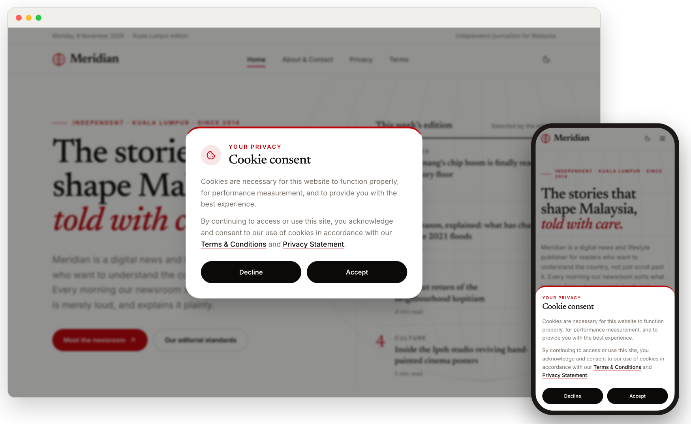
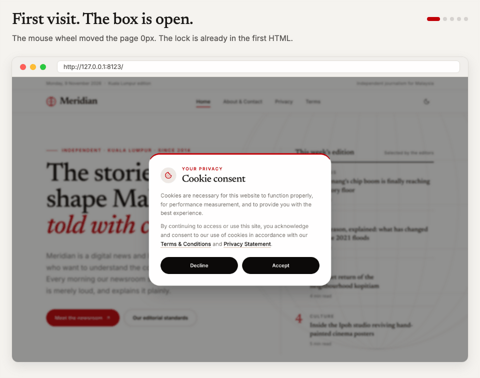
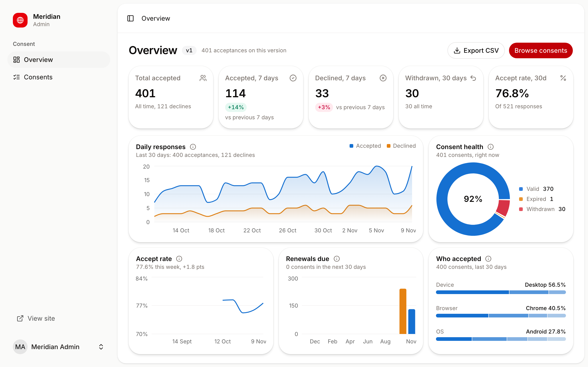
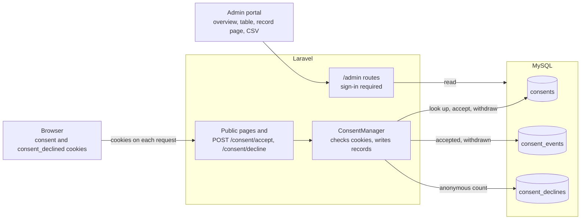
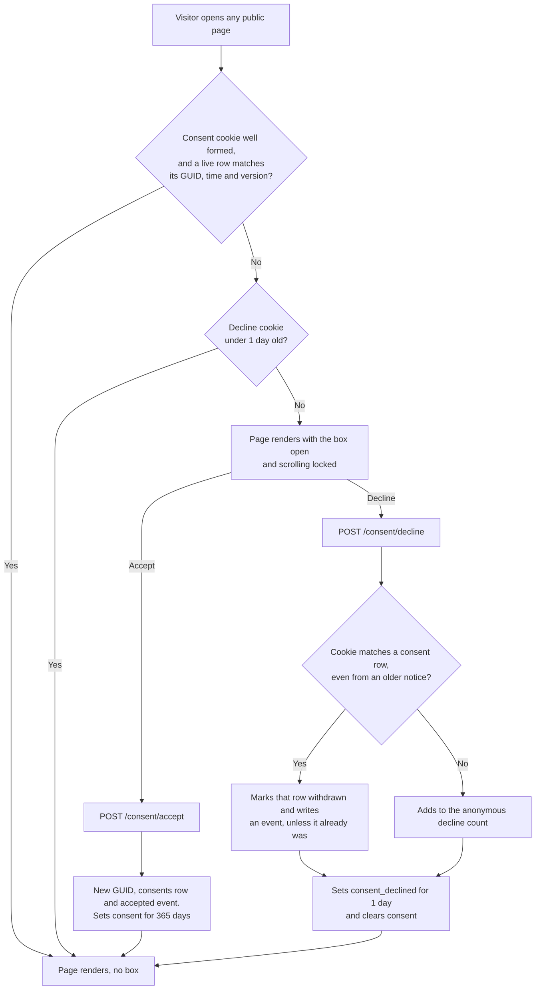

<a id="readme-top"></a>

<h1 align="center">
  <picture>
    <source media="(prefers-color-scheme: dark)" srcset="docs/readme/wordmark-dark.png">
    
  </picture>
</h1>

<p align="center">
  A news site with four core pages, five readable stories, a cookie consent gate, and an admin portal that shows every consent.
</p>

<p align="center">
  <a href="https://meridian-production-gohs21.laravel.cloud"><strong>Live site</strong></a> ·
  <a href="https://meridian-production-gohs21.laravel.cloud/admin"><strong>Admin portal</strong></a>
</p>

<p align="center">
  
  
  
  
  
  
</p>

<p align="center">
  <a href="#review-it-in-5-minutes">5-minute review</a> ·
  <a href="#the-brief-line-by-line">The brief</a> ·
  <a href="#run-it-locally">Run it locally</a> ·
  <a href="#read-the-code">Read the code</a> ·
  <a href="#try-to-break-it">Try to break it</a> ·
  <a href="#decisions-and-known-limits">Decisions and limits</a> ·
  <a href="#beyond-the-brief">Beyond the brief</a> ·
  <a href="#go-deeper">Go deeper</a>
</p>

<p align="center">
  <picture>
    <source media="(prefers-color-scheme: dark)" srcset="docs/readme/hero-dark.png">
    
  </picture>
</p>

## Review it in 5 minutes

All 8 requirements, the bonus admin portal and the deliverables are in this repo. Extras are marked, so you can skip them.

Use a private window on the [live site](https://meridian-production-gohs21.laravel.cloud). Cookies are in DevTools, under Application, then Cookies.

| #   | Do this                                                                                                        | You should see                                                                                                             | Brief |
| --- | -------------------------------------------------------------------------------------------------------------- | -------------------------------------------------------------------------------------------------------------------------- | ----- |
| 1   | Open the site. Try to scroll, then press Esc.                                                                  | The consent box is open. The page doesn't move and the box stays.                                                          | 3, 4  |
| 2   | Click Accept.                                                                                                  | The box closes and the page scrolls. The `consent` cookie holds a GUID, the time and version 1, for 1 year. Copy the GUID. | 6     |
| 3   | Reload, then open About.                                                                                       | No box.                                                                                                                    | 7     |
| 4   | Delete `consent`, reload, then click Decline.                                                                  | The box comes back, then closes. `consent_declined` holds the time, for 1 day.                                             | 7, 8  |
| 5   | Delete `consent_declined` and reload.                                                                          | The box comes back.                                                                                                        | 8     |
| 6   | Open the [admin portal](https://meridian-production-gohs21.laravel.cloud/admin), sign in, and search the GUID. | One matching row, Active.                                                                                                  | Bonus |

Sign in with `admin@meridian.test` and the password I sent with this submission. It's hosted on Laravel Cloud in Singapore, with MySQL 8.4. The same route works on [a local copy](#run-it-locally), where the password is `password`.

The same route, recorded. Every frame is a Playwright capture of a local run.

<p align="center">
  
</p>

<p align="right">(<a href="#readme-top">back to top</a>)</p>

## The brief, line by line

Numbers match the PDF. Every case ID links to its write-up in [`tests/cases/`](tests/cases), with the brief rule it proves.

| #           | The brief asks for                                                             | How to check it                                                                                                                                                                       | Code                                                                                                                          | Proved by                                                                                                                                                                                                                                                                               |
| ----------- | ------------------------------------------------------------------------------ | ------------------------------------------------------------------------------------------------------------------------------------------------------------------------------------- | ----------------------------------------------------------------------------------------------------------------------------- | --------------------------------------------------------------------------------------------------------------------------------------------------------------------------------------------------------------------------------------------------------------------------------------- |
| 1           | 4 pages                                                                        | Open `/`, `/about`, `/privacy` and `/terms`.                                                                                                                                          | [`routes/web.php`](routes/web.php#L14), [`pages/site/`](resources/js/pages/site)                                              | [CON-001](tests/cases/consent.yaml#L221)                                                                                                                                                                                                                                                |
| 2           | Mobile friendly                                                                | Narrow the window. Nothing scrolls sideways, and the box becomes a bottom sheet. Checked from 320px up, light and dark, and right to left.                                            | [`consent-dialog.tsx`](resources/js/components/site/consent/consent-dialog.tsx)                                               | [CON-002](tests/cases/consent.yaml#L253), [CON-003](tests/cases/consent.yaml#L287)                                                                                                                                                                                                      |
| 3           | Consent box on first visit, page can't scroll                                  | Open any page in a private window. The server decides, so the scroll lock is in the first HTML, before any JavaScript runs.                                                           | [`app.blade.php`](resources/views/app.blade.php#L45), [`ConsentManager.php`](app/Support/Consent/ConsentManager.php#L49)      | [CON-010](tests/cases/consent.yaml#L347), [CON-020](tests/cases/consent.yaml#L444), [CON-022](tests/cases/consent.yaml#L510)                                                                                                                                                            |
| 4           | The exact consent copy                                                         | Compare the box with the PDF, word for word.                                                                                                                                          | [`consent-dialog.tsx`](resources/js/components/site/consent/consent-dialog.tsx)                                               | [CON-011](tests/cases/consent.yaml#L372)                                                                                                                                                                                                                                                |
| 5           | Links to Terms and Privacy                                                     | Click both links in the box.                                                                                                                                                          | [`consent-dialog.tsx`](resources/js/components/site/consent/consent-dialog.tsx)                                               | [CON-012](tests/cases/consent.yaml#L403)                                                                                                                                                                                                                                                |
| 6           | Accept: cookie with GUID, time, version 1, lasts 1 year, saved to the database | Click Accept and read the `consent` cookie. Find its GUID in the admin.                                                                                                               | [`ConsentManager.php`](app/Support/Consent/ConsentManager.php#L69), [`schema.sql`](database/schema.sql)                       | [CON-030](tests/cases/consent.yaml#L551), [CON-031](tests/cases/consent.yaml#L605), [CON-032](tests/cases/consent.yaml#L638)                                                                                                                                                            |
| 7           | Box stays away until the cookie expires or is gone                             | Reload and change page. Then delete the cookie and reload. It's checked on the server on every page, and against the database.                                                        | [`ConsentManager.php`](app/Support/Consent/ConsentManager.php#L170)                                                           | [CON-033](tests/cases/consent.yaml#L670), [CON-040](tests/cases/consent.yaml#L781), [CON-041](tests/cases/consent.yaml#L809), [CON-072](tests/cases/consent.yaml#L1158)                                                                                                                 |
| 8           | Decline: cookie with the time, lasts 1 day, box returns                        | Click Decline and read `consent_declined`. Delete it and reload.                                                                                                                      | [`ConsentManager.php`](app/Support/Consent/ConsentManager.php#L107)                                                           | [CON-050](tests/cases/consent.yaml#L911), [CON-051](tests/cases/consent.yaml#L958), [CON-052](tests/cases/consent.yaml#L992)                                                                                                                                                            |
| Bonus       | Secured admin portal                                                           | `/admin`: overview, 30-day chart, consent health, accept rate, renewals due, device, browser and OS breakdowns, searchable table with a status filter, a page per record, CSV export. | [`Admin/ConsentController.php`](app/Http/Controllers/Admin/ConsentController.php), [`pages/admin/`](resources/js/pages/admin) | [ADM-002](tests/cases/admin.yaml#L272), [ADM-020](tests/cases/admin.yaml#L488), [ADM-030](tests/cases/admin.yaml#L654), [ADM-040](tests/cases/admin.yaml#L751), [ADM-043](tests/cases/admin.yaml#L865), [ADM-045](tests/cases/admin.yaml#L946), [ADM-049](tests/cases/admin.yaml#L1104) |
| Stack       | PHP 7 or 8 with MySQL                                                          | Laravel 13 on PHP 8.3+, with MySQL 8.4.                                                                                                                                               | [`composer.json`](composer.json)                                                                                              | Pest runs on MySQL 8.4 in CI                                                                                                                                                                                                                                                            |
| Deliverable | Source code and database scripts                                               | This repo. The scripts are `database/migrations`, plus `database/schema.sql` as plain SQL.                                                                                            | [`database/`](database)                                                                                                       | Pest runs on MySQL 8.4 in CI                                                                                                                                                                                                                                                            |
| Deliverable | README with local setup                                                        | [Run it locally](#run-it-locally), below.                                                                                                                                             |                                                                                                                               |                                                                                                                                                                                                                                                                                         |

<p align="right">(<a href="#readme-top">back to top</a>)</p>

## Run it locally

You need PHP 8.3+, Composer, Node 24 with pnpm, and MySQL 8 (MariaDB 10.11 works too).

```bash
git clone https://github.com/imanbinamran/meridian-consent.git meridian && cd meridian
mysql -u root -e "CREATE DATABASE meridian"
composer setup      # installs packages, writes .env, migrates, builds the frontend
php artisan db:seed # the admin account, 30 days of demo consents and one expired consent
composer dev        # http://localhost:8000
```

If your MySQL user isn't `root` with no password, set `DB_USERNAME` and `DB_PASSWORD` in `.env` before `composer setup`.

Log in at http://localhost:8000/login with `admin@meridian.test` / `password`.

<p align="right">(<a href="#readme-top">back to top</a>)</p>

## Read the code

Five files carry the consent logic. Read them in this order.

1. [`ConsentManager.php`](app/Support/Consent/ConsentManager.php). Start here. [`state()`](app/Support/Consent/ConsentManager.php#L49) decides if the box shows, and [`verifiedAccepted()`](app/Support/Consent/ConsentManager.php#L170) checks a cookie against the database.
2. [`ConsentController.php`](app/Http/Controllers/ConsentController.php). The Accept and Decline endpoints, and the cookies they set.
3. [`app.blade.php`](resources/views/app.blade.php#L45). The scroll lock, in the first HTML.
4. [`consent-dialog.tsx`](resources/js/components/site/consent/consent-dialog.tsx). The box, its exact copy and its two buttons.
5. [`config/consent.php`](config/consent.php). The version, cookie names, lifetimes and rate limit.

<p align="right">(<a href="#readme-top">back to top</a>)</p>

## Try to break it

I ran each of these on a local copy on 9 Nov 2026. To edit a cookie, open DevTools, then Application, then Cookies.

| Try this                                                                             | What happens                                                          |
| ------------------------------------------------------------------------------------ | --------------------------------------------------------------------- |
| Press Esc, or click outside the box                                                  | The box stays open.                                                   |
| Load a page with JavaScript off                                                      | `<html>` already has the `consent-locked` class and scrolling is off. |
| Change the year in `accepted_at` to 2099                                             | The box comes back.                                                   |
| Forge a cookie with a valid GUID and no row                                          | The box comes back.                                                   |
| Accept, decline, then restore the old `consent` cookie and delete `consent_declined` | The box comes back.                                                   |
| Type a fresh time into `consent_declined` by hand                                    | The box stays away for up to a day. Declines have no row to check.    |

<details>
<summary>10 more ways to try</summary>

| Try this                                             | What happens                                        |
| ---------------------------------------------------- | --------------------------------------------------- |
| Scroll with the box open                             | The page stays at 0px.                              |
| Press Tab over and over                              | Focus stays on the box's two links and two buttons. |
| Set the date to over a year ago                      | The box comes back.                                 |
| Change the GUID to `not-a-guid`                      | The box comes back.                                 |
| Keep a real GUID but move `accepted_at` back an hour | The box comes back.                                 |
| Replace the whole value with `hello`                 | The box comes back.                                 |
| Run locally with `CONSENT_VERSION=2` and a v1 cookie | The box comes back.                                 |
| Accept, reopen with "Cookie settings", accept again  | Same GUID, still one row.                           |
| Open `/admin` signed out                             | You land on the login page.                         |
| Open `/register`                                     | 404. Nobody can sign up.                            |

</details>

<p align="right">(<a href="#readme-top">back to top</a>)</p>

## Decisions and known limits

The five that shaped the build:

- **The server owns the decision.** The browser never creates consent cookies. The GUID, time and version come from the server. A cookie the browser sends back counts only if a live row agrees with it, and what gets stored comes from the server or that row. This keeps the cookie and the database row in step.
- **Accepting twice makes one row.** The buttons turn off while a choice is saving. After that, accepting with a verified cookie keeps its GUID and writes nothing.
- **The decline count holds no ID.** The brief only asks for a cookie on decline. I also store a count (version and time only, no GUID, no IP), so the admin can see the accept rate.
- **The version stays 1,** as the brief says. On a live product, adding device data would be a reason to raise it and ask everyone again.
- **No preference centre.** The site sets no optional cookies, so toggles would control nothing. The brief also fixes the choice as Accept and Decline.

What it doesn't do yet:

- **A copied cookie still works.** A real, live cookie moved to another browser passes, because the GUID is the only proof.
- **A hand-typed decline hides the box for up to a day.** Declines are anonymous, so there's no row to check. It records no consent.
- **A database outage is a 500.** Sessions live in the database, so pages fail first. The fallbacks only help on another session driver, and a failed Decline is a 500 on any driver.
- **Sessions still store IP and user agent.** That's Laravel's database session driver, for every visitor, including people who decline. The consent records hold neither.
- **Any verified user is an admin.** That's safe only because registration is off.
- **Phone checks ran in emulation.** Not on a real iPhone or Android yet.

<details>
<summary>The other decisions</summary>

- **A withdrawal isn't a decline in the count.** That person already has a record, so the record changes and the anonymous decline count doesn't.
- **Device data is three coarse fields:** device type, browser family and OS family. The server works them out on accept only. The raw user agent is never kept in the consent records. The breakdowns cover accepted visitors only, because declines carry no device data. iPadOS can report as macOS Desktop, so some iPads count as Macs.
- **Database outage.** On a page view, if the row lookup fails, a cookie that passes the format checks is trusted, so readers aren't locked out. Accept never does this. If the database can't answer, the visitor gets an error message, no cookie is set and nothing is called saved. Decline has no such handling yet, so a failed Decline is a 500. To be honest about how far the page view fallback goes: with `SESSION_DRIVER=database`, which is what this app uses, the page returns 500 anyway because sessions fail first. I tried both drivers with the database down. The fallback and the Accept message only help on another session driver.
- **Sessions still store IP and user agent.** Laravel's database session driver writes the raw IP and user agent to the `sessions` table for every visitor, including people who decline. That table is separate from the consent records, which don't hold either value, and the Privacy Statement says so. The fix is to move to a different session driver, such as Redis or cookies.
- **Times are stored in UTC and shown in Malaysia time.** The admin's date filters and chart use Kuala Lumpur days, so picking 12 Oct means 12 Oct as the admin sees it.
- **The admin can't be signed up for.** Registration is turned off. Login is rate limited to 5 tries a minute, and 2FA and passkeys are available in settings.
- **Accept and decline are rate limited** at 30 a minute per IP (`CONSENT_THROTTLE`).
- **Live updates can't hurt a visitor.** With live updates on, saving a choice only adds a job to the queue. With them off, nothing is queued. A worker talks to Pusher or Reverb, so an accept never waits on a socket server that's down, and a failure to queue is logged and ignored. The message says only "something changed". It carries no GUID, IP or device data, and the page then asks for the new numbers behind the admin login. A double click, a retry or a repeat decline changes nothing, so it sends nothing.
- **Ready for right-to-left.** Layouts use logical properties, so a Jawi or Arabic edition would mirror correctly. I tested it with `dir="rtl"`.

</details>

<p align="right">(<a href="#readme-top">back to top</a>)</p>

## Beyond the brief

You don't need any of this to mark the brief. It's here so you can tell what was asked for from what I added.

- event history for each consent, shown on its own page in the admin
- withdrawal, when someone declines after accepting
- coarse device data, kept on accept only
- browser and device breakdowns on the overview
- the database check that stops forged cookies
- HttpOnly on both cookies
- five readable sample stories at `/stories/{slug}`, behind the same consent gate ([STR-001](tests/cases/stories.yaml#L165) to [STR-022](tests/cases/stories.yaml#L683))
- a live admin overview over free Pusher or Laravel Reverb, off until it's switched on ([ADM-056](tests/cases/admin.yaml#L1373) to [ADM-067](tests/cases/admin.yaml#L1830))

The admin overview, with seeded demo data:

<p align="center">
  <picture>
    <source media="(prefers-color-scheme: dark)" srcset="docs/readme/admin-overview-dark.png">
    
  </picture>
</p>

<p align="right">(<a href="#readme-top">back to top</a>)</p>

## Go deeper

Open these only if you want the detail.

<details>
<summary><strong>How the consent works</strong></summary>

How the parts connect:



What happens on each visit:



**The cookies.** Both are set by the server and are left unencrypted, so you can read them in DevTools. Both are HttpOnly, so page scripts can't read them. The front end gets the choice from the page props instead.

```
consent           {"guid":"8f0c…","accepted_at":"2026-11-08T09:30:15Z","version":1}   expires in 365 days
consent_declined  2026-11-08T09:30:15Z                                                expires in 1 day
```

The `consent` value is URL-encoded in transit because it contains commas. Tick "Show URL-decoded" in Chrome's DevTools to read it as above.

**When the box comes back.** The server treats a cookie as missing when it has expired or when it doesn't check out. A `consent` cookie doesn't check out when:

- it isn't valid JSON,
- the GUID isn't a v4 UUID,
- the time is in the future or over a year old,
- the version is older than the current one,
- no row in `consents` has that GUID,
- that row has been withdrawn,
- or the row's time (to the second) or version differs from the cookie's.

So a hand-edited `consent` cookie can't hide the box while the database is up.

**Changing your mind.** Declining while holding an acceptance that matches its row marks that record withdrawn and writes an event. This works for a cookie from an older notice too. The `consent` cookie is cleared, and putting it back doesn't help because the row is no longer live. Declining again with that old cookie adds nothing. Accepting later issues a new GUID and a new row.

**Status in the admin.** Each record is one of three things, worked out when it's read:

- **Withdrawn:** the visitor declined after accepting. This wins over Expired.
- **Expired:** 365 days have passed since it was accepted, or it's on an older notice version than the current one.
- **Active:** neither of those.

The table badge, the record page, the status filter and the CSV all use the same rule.

**Versions.** `CONSENT_VERSION` in `.env` is the version of the notice. Raise it to 2 and every visitor who accepted version 1 sees the box again. That's how you'd handle a change to the Privacy Statement.

**Scroll lock before JavaScript.** The server works out whether the box is needed. When it is, the server puts a `consent-locked` class on `<html>` and an inline style turns off scrolling. React removes the class once the visitor chooses. While the box is open, the page behind it is `inert`, so keyboard and screen reader users can't reach it either.

**The box itself.** It's an accessible alert dialog. Esc and clicking outside don't close it on a first visit. Accept and Decline look the same, so neither is pushed. On phones it's a bottom sheet. "Cookie settings" in the footer reopens it, so a visitor can change their mind.

</details>

<details>
<summary><strong>Tests</strong></summary>

Last full run on 9 Nov 2026: every test below passed, apart from the two real-server tests that are skipped by default.

- **Pest:** 304 tests (2,078 assertions) cover every consent rule, the admin portal, live updates and the stories. Time travel checks the 1-year and 1-day expiry.
- **Playwright:** 152 tests cover consent, scroll lock, accessibility (axe), phone layout, the article pages, the live overview and the admin in desktop Chrome. The consent, phone-layout and article tests also run on an emulated Pixel 7. One test runs the whole story above: accept on the site, log in as admin, and find that cookie's GUID in the table.
- **Test cases:** `tests/cases/*.yaml` lists every case and which brief rule it proves.
- **CI:** GitHub Actions runs lint, PHPStan, Pest on SQLite and MySQL 8, and the Playwright suite on every push.

```bash
php artisan test                                  # Pest
pnpm exec playwright install chromium             # once
pnpm test:e2e                                     # Playwright (starts the app itself)
```

The live overview tests use a fake socket, so neither CI nor your machine needs Reverb or a Pusher account. Two tests use a real server across two browsers, and both are skipped by default. One needs the app on Reverb and `E2E_REVERB=1`. The other needs the `pusher` connection pointed at a local Reverb through `PUSHER_HOST`, `PUSHER_PORT` and `PUSHER_SCHEME`, and `E2E_PUSHER_LOCAL=1`.

</details>

<details>
<summary><strong>Live overview setup</strong></summary>

The admin overview updates by itself when someone accepts, declines or withdraws. A green **Live** badge next to the title says it's on. If the connection drops the badge reads **Disconnected**, and the numbers stay until it comes back. It reconnects by itself and catches up.

It's off by default, so the app runs without it. It can run on free Pusher or on Reverb, and `BROADCAST_CONNECTION` in `.env` picks which. Either way you need a queue worker, because the app sends each update from the queue. `composer dev` starts one.

- **Pusher:** nothing to host, and the free plan is enough. Create a Channels app, then set `BROADCAST_CONNECTION=pusher`, `PUSHER_APP_ID`, `PUSHER_APP_KEY`, `PUSHER_APP_SECRET` and `PUSHER_APP_CLUSTER`.
- **Reverb:** you run the socket server yourself. Set `BROADCAST_CONNECTION=reverb`. `composer dev` starts Reverb on your own machine, and the Reverb values in `.env.example` work there. If something else is on port 8080, set `REVERB_PORT` and `REVERB_SERVER_PORT` to a free one. On a server you need Reverb running too.

If a setting is missing, the page shows no badge and the app queues nothing for it.

The stats, chart and recent list are live. The browser and device breakdowns refresh on page load.

</details>

<details>
<summary><strong>Where things are</strong></summary>

```
app/Support/Consent/        checking cookies against the database, withdrawals, device parsing
app/Http/Middleware/        shares the consent state with every public page
app/Http/Controllers/       consent accept and decline, admin overview, table and record page
app/Events/                 the "consents changed" broadcast
routes/channels.php         who may listen to it
resources/js/pages/site/    the four public pages and the story page
resources/js/pages/admin/   admin overview, consents table and record page
config/consent.php          version, cookie names, lifetimes, rate limit
database/schema.sql         the schema as plain SQL
tests/Feature/              Pest
tests/e2e/                  Playwright
```

</details>

## What I'd add next

- **Admin roles.** Any verified user is an admin today. That's safe only because registration is off.
- **Server-side rendering.** The page needs JavaScript to show content. Inertia SSR would make it work without it.
- **Bahasa Malaysia.** The layout is ready for translation, but the copy is English only.
- **A retention period.** Consent records and the decline count are kept with no end date today. I'd set one and prune past it.
- **Real phones.** Phone checks ran in emulation. I'd confirm safe areas and tap behaviour on a real iPhone and Android.

<p align="right">(<a href="#readme-top">back to top</a>)</p>
