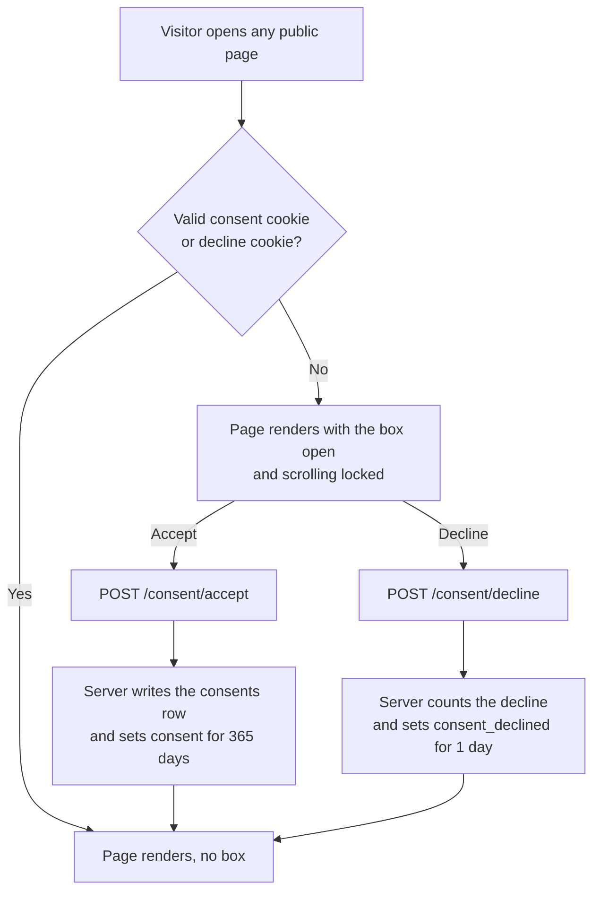

# Meridian

A four-page news site with a cookie consent gate and an admin portal to view the consents. Built with Laravel 13, Inertia, React, shadcn/ui and MySQL.

**Live:** [TK: live URL] · **Admin:** [TK: live URL]/admin, `admin@meridian.test` / [TK: password shared separately]

| Brief | Where it lives |
| --- | --- |
| 4 pages, mobile friendly | `/`, `/about`, `/privacy`, `/terms`. Checked from 320px up, light and dark, and right to left. |
| Consent box on first visit, page can't scroll | The server decides, so the scroll lock is in the first HTML, before any JavaScript runs. |
| Exact copy, with links to Terms and Privacy | `resources/js/components/site/consent/consent-dialog.tsx` |
| Accept: cookie with GUID, time, version 1, lasts 1 year, saved to the database | `consent` cookie plus a row in `consents` |
| Box stays away until the cookie expires or is gone | Checked on the server on every page |
| Decline: cookie with the time, lasts 1 day | `consent_declined` cookie |
| Bonus: secured admin portal | `/admin`: overview, 30-day chart, searchable table, CSV export |
| Database scripts | `database/migrations`, plus `database/schema.sql` as plain SQL |

## Run it locally

You need PHP 8.3+, Composer, Node 24 with pnpm, and MySQL 8 (MariaDB 10.11 works too).

```bash
git clone [TK: repo URL] meridian && cd meridian
mysql -u root -e "CREATE DATABASE meridian"
composer setup      # installs packages, writes .env, migrates, builds the frontend
php artisan db:seed # the admin account plus 30 days of demo consents
composer dev        # http://localhost:8000
```

If your MySQL user isn't `root` with no password, set `DB_USERNAME` and `DB_PASSWORD` in `.env` before `composer setup`.

Log in at http://localhost:8000/login with `admin@meridian.test` / `password`.

## How the consent works



**The cookies.** Both are set by the server and are left unencrypted, so you can read them in DevTools.

```
consent           {"guid":"8f0c…","accepted_at":"2026-11-08T09:30:15Z","version":1}   expires in 365 days
consent_declined  2026-11-08T09:30:15Z                                                expires in 1 day
```

The `consent` value is URL-encoded in transit because it contains commas. DevTools shows it decoded.

**When the box comes back.** The server treats a cookie as missing when it has expired or when it doesn't check out. A cookie doesn't check out when:
- it isn't valid JSON,
- the GUID isn't a v4 UUID,
- the time is in the future or over a year old,
- or the version is older than the current one.

So a hand-edited cookie can't hide the box.

**Versions.** `CONSENT_VERSION` in `.env` is the version of the notice. Raise it to 2 and every visitor who accepted version 1 sees the box again. That's how you'd handle a change to the Privacy Statement.

**Scroll lock before JavaScript.** The server works out whether the box is needed. When it is, the server puts a `consent-locked` class on `<html>` and an inline style turns off scrolling. React removes the class once the visitor chooses. While the box is open, the page behind it is `inert`, so keyboard and screen reader users can't reach it either.

**The box itself.** It's an accessible alert dialog. Esc and clicking outside don't close it on a first visit. Accept and Decline look the same, so neither is pushed. On phones it's a bottom sheet. "Cookie settings" in the footer reopens it, so a visitor can change their mind.

## Decisions and trade-offs

- **The server owns the decision.** The browser never creates consent cookies. The GUID, time and version come from the server, and anything the client sends is ignored. This keeps the cookie and the database row in step.
- **Accepting twice makes one row.** A retry or a double click reuses the GUID from a valid cookie, and the insert is `firstOrCreate` on the GUID.
- **Declines are counted, never identified.** The brief only asks for a cookie on decline. I also store an anonymous count (version and time only, no GUID, no IP), so the admin can see the accept rate without tracking people who said no.
- **Times are stored in UTC and shown in Malaysia time.** The admin's date filters and chart use Kuala Lumpur days, so picking 12 Oct means 12 Oct as the admin sees it.
- **The admin can't be signed up for.** Registration is turned off. Login is rate limited to 5 tries a minute, and 2FA and passkeys are available in settings.
- **Accept and decline are rate limited** at 30 a minute per IP (`CONSENT_THROTTLE`).
- **Ready for right-to-left.** Layouts use logical properties, so a Jawi or Arabic edition would mirror correctly. I tested it with `dir="rtl"`.

## Tests

- **Pest:** 138 tests (1,125 assertions) cover every consent rule and the admin portal. Time travel checks the 1-year and 1-day expiry.
- **Playwright:** 74 tests cover consent, scroll lock, accessibility (axe), phone layout and the admin in desktop Chrome. The consent and phone-layout tests also run on an emulated Pixel 7. One test runs the whole story: accept on the site, log in as admin, and find that cookie's GUID in the table.
- **Test cases:** `tests/cases/*.yaml` lists every case and which brief rule it proves.
- **CI:** GitHub Actions runs lint, PHPStan, Pest on SQLite and MySQL 8, and the Playwright suite on every push.

```bash
php artisan test                                  # Pest
pnpm exec playwright install chromium             # once
pnpm test:e2e                                     # Playwright (starts the app itself)
```

## Where things are

```
app/Support/Consent/        reading, checking and writing the consent cookies
app/Http/Middleware/        shares the consent state with every public page
app/Http/Controllers/       consent accept and decline, admin overview and table
resources/js/pages/site/    the four public pages
resources/js/pages/admin/   admin overview and consents table
config/consent.php          version, cookie names, lifetimes, rate limit
database/schema.sql         the schema as plain SQL
tests/Feature/              Pest
tests/e2e/                  Playwright
```

## What I'd add next

- **Record withdrawals.** Choosing Decline after Accept clears the cookie, but the old acceptance row stays as it is. I'd add a `withdrawn_at` column so the record shows the change of mind.
- **Admin roles.** Any verified user is an admin today. That's safe only because registration is off.
- **Server-side rendering.** The page needs JavaScript to show content. Inertia SSR would make it work without it.
- **Bahasa Malaysia.** The layout is ready for translation, but the copy is English only.
- **Real phones.** Phone checks ran in emulation. I'd confirm safe areas and tap behaviour on a real iPhone and Android.
